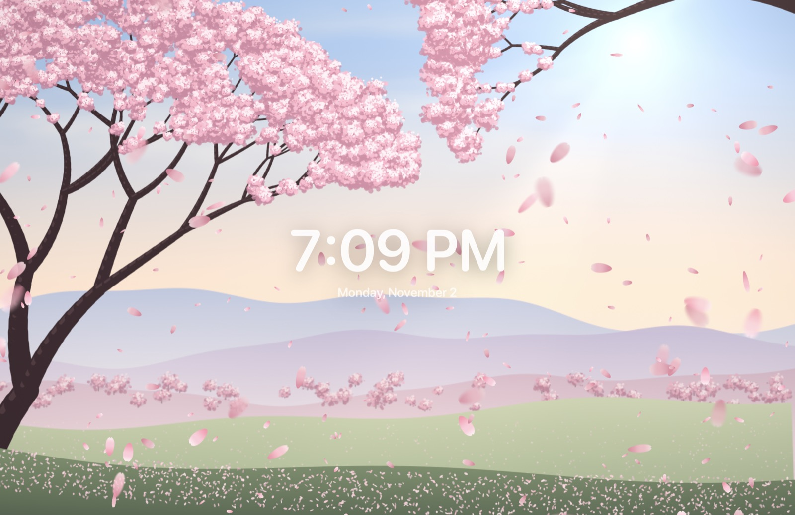
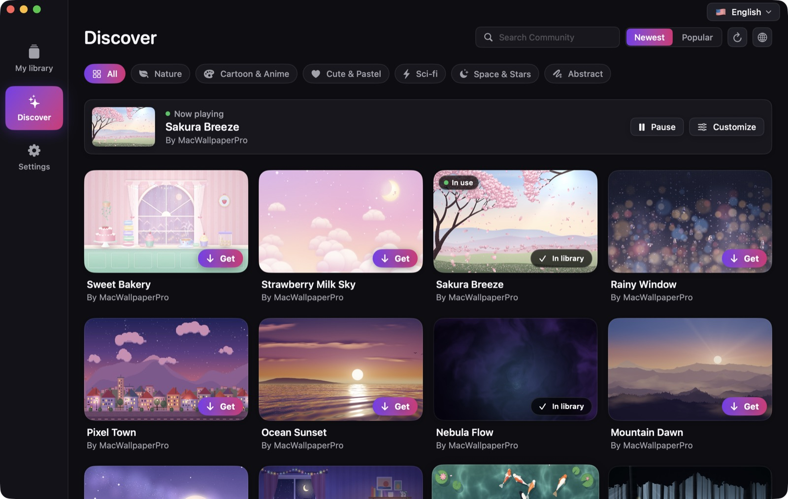
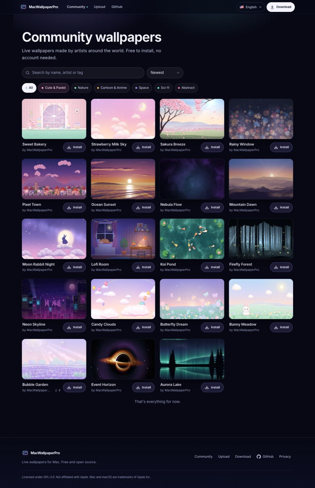

<p align="center">
  
</p>

<h1 align="center">MacWallpaperPro</h1>

<p align="center">
  Live, interactive wallpapers for macOS — free and open source.<br>
  <a href="https://macwallpaper.elizos.com">Website & Community</a> ·
  <a href="https://macwallpaper.elizos.com/download">Download</a> ·
  <a href="https://macwallpaper.elizos.com/privacy">Privacy</a> ·
  <a href="SECURITY.md">Security</a> ·
  <a href="CONTRIBUTING.md">Contributing</a>
</p>

<p align="center">
  
</p>

---

MacWallpaperPro turns your desktop into something alive. Wallpapers react to your cursor — petals drift in the wind you make, koi follow your pointer, clicks send ripples across a lake. Pick one from the free Community store and it's on your desktop in one click.

## Features

- **Interactive live wallpapers** — WebGL/Canvas scenes that respond to mouse movement and clicks, plus video and web-page wallpapers
- **Free Community store** — 19+ wallpapers (nature, cute & pastel, cartoon, sci-fi, space), one-click install, no account needed
- **Safe by design** — every Community file is reviewed, Ed25519-signed and SHA-256 verified; wallpapers run offline in a sandbox with all network access blocked
- **Desktop clock** — font, color, size and position of your choice
- **Window tools** — glowing border around the focused window, keyboard window snapping (halves, quarters, maximize, next display)
- **Menu bar** — hide cluttered icons behind one button, or replace the bar with a custom one
- **Auto-quit** — quit apps when their last window closes
- **Lock screen** — use the current wallpaper frame as your lock screen image
- **17 languages** with live switching, including right-to-left Arabic

Requires **macOS 15 or later**.

## Screenshots

| The app's Discover page | The Community website |
|---|---|
|  |  |

## Install

1. Download **MacWallpaperPro.zip** from the [latest GitHub release](https://github.com/amontheptanlaeo/MacWallpaperPro/releases/latest)
   (or from <https://macwallpaper.elizos.com/download>, which points to the same file).
2. Double-click the zip to unpack it, then drag **MacWallpaperPro.app** into your **Applications** folder.
3. Open it. Release builds are signed with a Developer ID and notarized by Apple, so macOS opens them
   without warnings.
4. Optional: the window border, window snapping and auto-quit tools need **Accessibility** access.
   The app asks when you turn one of them on; allow it in **System Settings → Privacy & Security →
   Accessibility**. Wallpapers, the clock and the Community store work without it.

To update, download the new release and replace the app in Applications. Installed Community
wallpapers and your settings are kept. To uninstall, quit the app, delete it from Applications and
optionally remove `~/Library/Application Support/MacWallpaperPro`.

**Privacy:** the app shows no ads, needs no account and only contacts the website to browse and
download wallpapers; installed wallpapers can't reach the internet. The website keeps only
anonymous, aggregated counts (downloads and page views by country and referrer, no IP addresses). Details: <https://macwallpaper.elizos.com/privacy>.

## Build from source

Prerequisites: macOS 15+, Xcode 16 or later (Swift 6 toolchain). For the website: Node.js 22.

```bash
./build.sh                    # builds build/MacWallpaperPro.app
open build/MacWallpaperPro.app
```

`build.sh` signs with your *Developer ID Application* certificate if one is installed (so Accessibility permission survives rebuilds), otherwise ad-hoc.

To produce a notarized, distributable build:

```bash
./release.sh 1.0.0            # build → sign → notarize → staple → dist/MacWallpaperPro.zip
./release.sh 1.0.0 --no-notarize
gh release create v1.0.0 dist/MacWallpaperPro.zip dist/MacWallpaperPro.zip.sha256 --title v1.0.0 --generate-notes
```

The release asset must be named `MacWallpaperPro.zip`: the website's `/download` and the install
link use `releases/latest/download/MacWallpaperPro.zip`. Signing settings come from environment
variables, so forks can use their own Apple account: `TEAM_ID`, `SIGN_IDENTITY`, `ASC_KEY_ID`,
`ASC_ISSUER` and `ASC_KEY_PATH` (see the top of `release.sh`; the defaults are the upstream
maintainer's identifiers).

Regenerate the app icon with `swift scripts/make-icon.swift`.

## Project layout

| Path | What it is |
|---|---|
| `Sources/MacWallpaperPro/` | The macOS app (Swift/SwiftUI) |
| ├ `Wallpaper.swift` | Desktop-level wallpaper windows, cursor forwarding into web wallpapers, clock |
| ├ `Community.swift` | Community client, signed installs, offline sandbox rules |
| ├ `LibraryView.swift`, `DiscoverView.swift`, `MainWindow.swift`, `SettingsPages.swift`, `DesignSystem.swift` | UI |
| ├ `WindowBorder.swift`, `WindowSnap.swift`, `MenuBarHider.swift`, `CustomMenuBar.swift`, `TrueQuit.swift` | Desktop tools |
| └ `I18n.swift` | Localization (tables in `Localization/*.json`) |
| `Wallpapers/` | Built-in and launch Community wallpapers (one self-contained `index.html` each) |
| `web/` | Website, Community store and API — Cloudflare Worker + D1 + R2 ([web/README.md](web/README.md)) |
| `docs/ARCHITECTURE.md` | App ↔ server contract, security model, manifest signing |
| `design-system/MASTER.md` | UI design rules for the app |

## Making your own wallpaper

A wallpaper is a single self-contained `index.html` (≤ 10 MB, no external requests). It receives standard DOM events — `mousemove`, `mousedown`, `mouseup`, `click` — from the real cursor (clicks only when they land on the desktop). Optionally define `window.setP = ({ speed }) => …` to follow the app's speed setting. Submit it at [macwallpaper.elizos.com/community/upload](https://macwallpaper.elizos.com/community/upload).

## Localization

App strings live in `Localization/<code>.json` (English keys → translation); website strings in `web/public/i18n/<code>.json`. Check them with `python3 scripts/check-localization.py` (app) and `cd web && npm run check:i18n` (website). Corrections and new languages are welcome via pull request.

## Contributing

Bug reports, wallpapers, translations and code are welcome. Read [CONTRIBUTING.md](CONTRIBUTING.md)
and the [Code of Conduct](CODE_OF_CONDUCT.md). Changes are listed in [CHANGELOG.md](CHANGELOG.md).
Report security problems privately (see [SECURITY.md](SECURITY.md)).

## Support

MacWallpaperPro is free, with no ads in the app and no paid features. If you'd like to support its
development, thank you:

- [Sponsor on GitHub](https://github.com/sponsors/amontheptanlaeo)
- [Buy me a coffee on Ko-fi](https://ko-fi.com/amontheptanlaeo)

Starring the repo, sharing a wallpaper or fixing a translation helps just as much.

## License

MacWallpaperPro is open source under the [GNU General Public License v3.0](LICENSE).

- You may use, modify and redistribute it, including commercially.
- If you distribute it (modified or not), you must release the source under GPL-3.0, keep the [`NOTICE`](NOTICE) file, and credit "MacWallpaperPro by Amonthep tanlaeo".
- The **MacWallpaperPro** name and logo are not covered by the GPL — forks must use a different name. See [TRADEMARKS.md](TRADEMARKS.md).
- Community wallpapers belong to their respective creators.

Not affiliated with Apple. Mac and macOS are trademarks of Apple Inc.

Copyright © 2026 Amonthep tanlaeo
